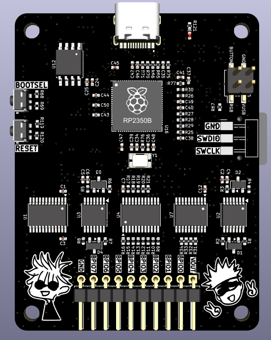
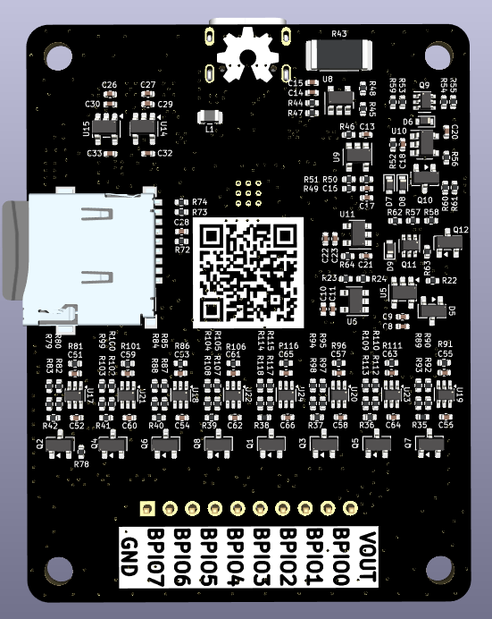

# RB-Pirate

**An RP2350B multi-protocol hardware exploration and debugging tool**

RB-Pirate helps developers, makers, and hardware enthusiasts communicate with,
analyze, and debug electronic devices directly from a terminal. With the matching firmware, it provides serial-bus interaction, logic capture,
voltage measurement, configurable target power, and hardware automation.

## Hardware inspiration and firmware authorship

The RB-Pirate hardware was designed by **Reza Bakhshi**, inspired by the
[Bus Pirate 6 hardware](https://docs.buspirate.com/docs/hardware/bp6rev2/introduction/)
from [Dangerous Prototypes](https://dangerousprototypes.com/).

The **[RB-Pirate firmware](https://github.com/reza-bakhshi/RB-Pirate-Firmware)**
was written from scratch by Reza Bakhshi with a new, custom architecture.
The hardware inspiration and firmware authorship are separate: Bus Pirate
is the hardware reference, while RB-Pirate has its own firmware implementation.
Third-party libraries and components retain their respective credits and licenses.

## Start here

This repository contains the KiCad hardware design. Open [RB-Pirate.kicad_pro](RB-Pirate.kicad_pro) to inspect the schematic and PCB together.

| Resource | Contents |
|---|---|
| [RB-Pirate.kicad_sch](RB-Pirate.kicad_sch) | Schematic entry point |
| [RB-Pirate.kicad_pcb](RB-Pirate.kicad_pcb) | PCB layout |
| [img](img) | Board renders |
| [Custom firmware](https://github.com/reza-bakhshi/RB-Pirate-Firmware) | Build, flashing, terminal operation, and protocol guides |
| [Host automation](https://github.com/reza-bakhshi/RB-Pirate-Skill) | Python serial runner and agent reference material |

Firmware determines which protocol modes and tools are available. RF, infrared, and NFC workflows require the corresponding external hardware; those modules are not built into the base board.

## PCB gallery

<table>
  <tr>
    <th width="50%">Top</th>
    <th width="50%">Bottom</th>
  </tr>
  <tr>
    <td></td>
    <td></td>
  </tr>
</table>

## Hardware features

### RP2350B platform

- Raspberry Pi RP2350B microcontroller
- 128 Mbit program flash
- Dual-core processing and flexible PIO peripherals
- USB-C host connection
- Built-in USB bootloader for straightforward firmware updates
- SWD header, BOOTSEL button, and RESET button
- Two-layer, 1.6 mm PCB designed with KiCad 10

### Eight buffered I/O pins

- 1.65 V to 5 V operating range
- Three-state outputs
- Voltage measurement on every I/O pin
- Individually controllable 10 kΩ pull-up resistors
- Standard 10-pin, 2.54 mm header with GND, BPIO7–BPIO0, and VOUT

### Programmable target power supply

- Programmable 1 V to 5 V output
- Programmable 0 mA to 500 mA current limit
- Real-time current sensing
- Resettable digital fuse
- Output protection circuitry

### Removable microSD storage

- Stores global and protocol-mode settings
- Provides space for logs, captures, dumps, and scripts
- Accessible through the firmware's USB storage interface
- Removable and easy to replace or upgrade

## Software features

### Terminal and logic analysis

- Color VT100 terminal interface
- Live status toolbar with voltage and current monitoring
- Follow-Along Logic Analyzer capture while commands are executed
- Live bus-activity inspection and analysis workflows

### Protocols and workflows

- I²C, SPI, UART, half-duplex UART, 1-Wire, 2-Wire, and 3-Wire communication
- Digital I/O and serial LED control
- JTAG and SWD discovery
- Logic capture and protocol analysis
- EEPROM, flash, FRAM, sensor, and smart-card interaction
- Firmware programming, memory access, scripting, and automation workflows

## Firmware

> [!IMPORTANT]
> ### Use the custom RB-Pirate firmware
>
> Install firmware only from the
> **[RB-Pirate Firmware repository](https://github.com/reza-bakhshi/RB-Pirate-Firmware)**.
> Do not use the mainline Bus Pirate firmware on this board. The custom firmware
> provides the correct hardware configuration, microSD support, and optional
> RGB & Button HAT integration for RB-Pirate.

Build instructions, firmware releases, installation steps, and update
instructions are maintained in the custom firmware repository.

## Optional RGB & Button HAT

The **[RB-Pirate RGB & Button HAT](https://github.com/reza-bakhshi/RB-Pirate-RGB-HAT)**
adds RGB visual feedback and a programmable user button.

The optional HAT provides:

- RGB status indication and animations
- Introduction and party-mode effects
- A button for escaping from active modes
- Scriptable user input for automation and custom workflows

RB-Pirate operates normally without the HAT. Add it only when RGB feedback or
physical button input is useful for your setup.

## License

RB-Pirate is released under the [MIT License](LICENSE).

Third-party components and libraries remain subject to their respective
licenses.

---

  Built for hardware exploration, debugging, and experimentation.

